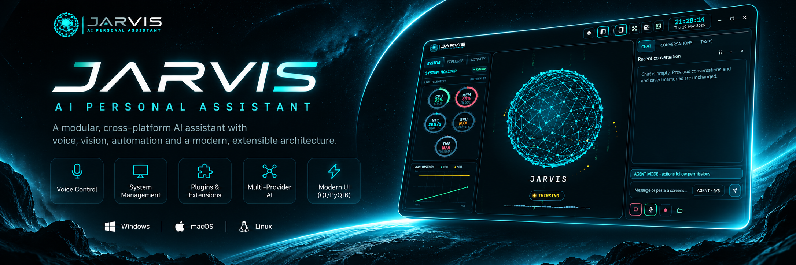
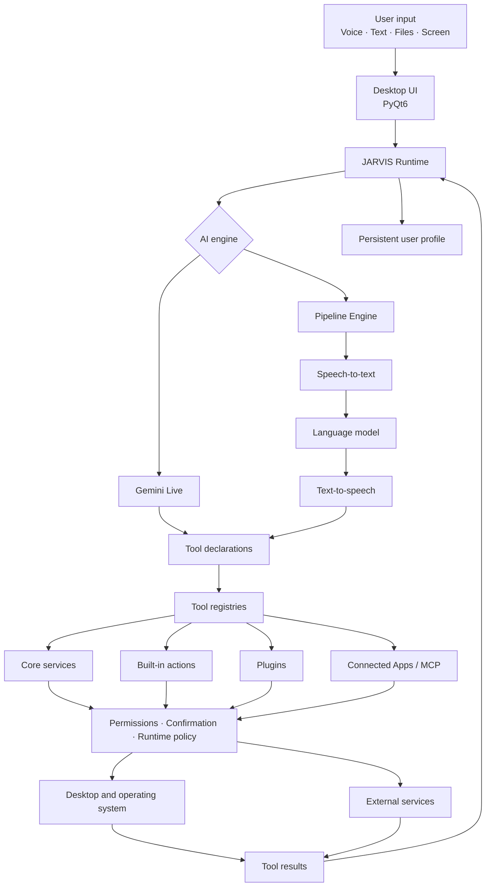

# JARVIS

<p align="center">
  
</p>

<p align="center">
  <strong>Your Desktop. Your Intelligence. Your Control.</strong><br>
  A modular desktop AI assistant that brings voice, AI models, memory, automation and connected services into one workspace.
</p>

<p align="center">
  <a href="https://github.com/RustamovAkrom/JARVIS/actions/workflows/tests.yml?query=branch%3Amain"></a>
  <a href="https://github.com/RustamovAkrom/JARVIS/actions/workflows/tests.yml?query=branch%3Ag%6cm-ui-ux-modernization"></a>
  
  
  
  <a href="https://github.com/RustamovAkrom/JARVIS/releases/latest"></a>
  <a href="LICENSE"></a>
</p>

<p align="center">
  <a href="#overview">Overview</a> ·
  <a href="#capabilities">Capabilities</a> ·
  <a href="#architecture">Architecture</a> ·
  <a href="#ai-engine-and-providers">AI providers</a> ·
  <a href="#connected-apps-and-mcp">Connected Apps & MCP</a> ·
  <a href="#installation">Installation</a> ·
  <a href="#development">Development</a>
</p>

---

## Overview

JARVIS is a cross-platform desktop AI assistant built to connect conversational AI with the user's desktop environment. It combines real-time voice interaction, configurable AI engines, persistent memory, computer tools, extensible plugins and external integrations in a single desktop application.

JARVIS is designed around a separation of responsibilities:

- **The AI proposes; the application enforces.** Models can request declared tools, but local runtime code validates and dispatches every operation.
- **Capabilities are explicit.** Tool availability depends on the selected engine, permissions, application mode and enabled integrations.
- **Extensions are modular.** Core services, built-in actions, plugins and connected apps have separate responsibilities.
- **User data is persistent.** Configuration, conversations, memory, tasks, logs and plugin data are stored separately from replaceable application files.
- **The interface is operational, not decorative.** The HUD, chat, activity, system telemetry, project workspace, editor and terminal are integrated into the application workflow.

JARVIS is actively developed. The repository's default branch is `main`; this README describes the implementation in the `glm-ui-ux-modernization` development branch. Stable packaged releases are currently produced for Windows. macOS and Linux users can run the application from source, subject to platform-specific limitations.

## Capabilities

### Voice and conversation

- Real-time voice conversations with Gemini Live.
- Text-based chat with persistent conversation history.
- Streaming speech responses and interruption controls.
- Microphone selection, audio output configuration and push-to-talk.
- Optional local **Hey JARVIS** wake-word detection.
- Configurable assistant identity and voice.
- File, image and screenshot attachments for contextual requests.

Wake-word detection can run locally. This does not make the entire conversation pipeline offline: audio and prompts are processed by the currently selected engine.

### Vision and desktop interaction

- Screen capture and visual question answering.
- Webcam capture for supported camera workflows.
- Application launching and URL opening.
- Screen inspection and supported UI element discovery.
- Mouse, keyboard, clipboard and window operations.
- Supported operating-system controls such as volume and brightness.
- Approval gates for selected high-impact operations.

Computer interaction is permission-controlled. Chat mode blocks mutating computer actions; Agent mode enables eligible operations only when the relevant permissions are granted. Platform APIs and desktop-session restrictions affect feature availability.

### AI-assisted workspace

- Select a project directory and browse its files.
- Read project files and inspect the active editor context.
- Open files in the built-in editor or the system application.
- Start terminal sessions in the selected project directory.
- Use coding tools to create, explain, modify and run code.
- Process supported documents, spreadsheets, images, media and archives.

The project workspace's dedicated file-reading capability is scoped to the selected project. Other coding and file tools can have write or execution capabilities and are governed separately.

### Memory and productivity

- Separate persistent conversations and long-term memory.
- Search and manage saved memory entries.
- Background research tasks with status, results and cancellation.
- Topic monitoring and timed reminders.
- Task reports and persistent task workspaces.
- Optional productivity features provided by plugins.

Chat history and long-term memory are different data stores. Removing one does not automatically remove the other.

### HUD and system monitoring

- Animated orbital assistant interface and live status.
- CPU, memory, network and supported GPU/temperature telemetry.
- Resource history and diagnostic views.
- Chat, conversations, activity and background task panels.
- Project explorer, editor and terminal.
- Optional live dashboards provided by plugins.

Sensor availability depends on the host hardware, drivers and operating system. Unsupported metrics may display as unavailable.

### Remote access

JARVIS provides optional remote workflows, including a paired-device Remote Dashboard and a Telegram Remote plugin. They use different connection models and have separate configuration and security requirements. Review [Remote access security](#remote-access-security) before enabling them.

## Architecture

JARVIS uses a layered architecture. The desktop UI presents state and collects input; the runtime coordinates sessions; AI engines handle conversation; registries expose approved tools; and core services manage persistence, permissions and execution.

### High-level flow



### Main project areas

| Path | Responsibility |
|---|---|
| `main.py` | Application runtime, live sessions, audio/text routing, tool declarations, dispatch and lifecycle management. |
| `ui.py` | UI entry point and compatibility-facing application imports. |
| `gui/` | Main window, panels, settings pages and desktop interaction. |
| `core/` | Runtime services, permissions, confirmations, action/plugin loading, connected-app infrastructure and platform support. |
| `actions/` | Built-in assistant tools discovered through the action registry. |
| `plugins/` | Optional feature modules and integrations. |
| `providers/` | AI provider contracts, provider discovery and the alternative STT/LLM/TTS pipeline. |
| `memory/` | Configuration, conversations, saved memory and related persistence services. |
| `dashboard/` | Paired-device remote dashboard and its local API. |
| `docs/` | Setup guides, plugin documentation and UI/architecture references. |
| `tests/` | Unit and regression tests for runtime, UI, integrations and platform behavior. |

### Tool execution lifecycle

1. **Discovery:** JARVIS loads core tools, built-in actions, enabled plugins and connected-app tools.
2. **Validation:** registries validate tool metadata, schemas, handlers and duplicate names.
3. **Capability filtering:** the active engine receives only tools compatible with its supported capabilities.
4. **Tool request:** the model returns a structured tool call.
5. **Policy checks:** JARVIS evaluates application mode, permissions and confirmation requirements.
6. **Execution:** the relevant local handler or connected service performs the operation.
7. **Result:** the runtime records the outcome and returns the result to the conversation.

The model does not receive unrestricted direct access to the operating system. The local runtime remains responsible for dispatch and policy enforcement.

### Extension model

JARVIS has distinct extension layers:

- **Core tools and services** implement functionality closely coupled to runtime state, permissions or application lifecycle.
- **Actions** provide reusable built-in assistant tools. An action module declares a `TOOL` definition and a handler.
- **Plugins** add optional capabilities. A plugin declares its metadata and a `run()` handler, and may provide settings for the UI.
- **Connected Apps** manage external service connections, credentials, authentication and tool execution. MCP servers can expose additional tools through supported transports.

This separation keeps the main runtime focused on orchestration and gives each extension type a clear integration contract.

## AI engine and providers

JARVIS supports two conversation paths.

### Gemini Live

Gemini Live is the integrated real-time conversational engine. It supports the default voice-first experience and the engine's supported multimodal and tool-calling capabilities.

### Pipeline Engine

The alternative pipeline combines independently configured providers:

| Component | Responsibility |
|---|---|
| STT | Converts microphone audio into text. |
| LLM | Generates responses and tool calls. |
| TTS | Converts generated text into speech. |

Providers are selected through the Engine & Providers settings. Depending on the provider, the pipeline can use local model servers or hosted APIs. Compatible local services can include Ollama, LM Studio, llama.cpp and vLLM; hosted endpoints can use supported OpenAI-compatible APIs.

A fully local voice workflow requires local implementations for every configured stage. Selecting a local LLM alone does not make speech recognition, speech synthesis, web search or connected services local.

### Capability-aware tools

Models and providers differ in their support for:

- Function/tool calling.
- Image and vision input.
- Audio output.
- Non-blocking tool execution.
- Tool schema formats and tool-call budgets.

JARVIS uses provider capability metadata to avoid exposing incompatible tools to an engine. A model's compatibility should be verified with the configured provider rather than inferred from its name.

For setup and provider-specific guidance, see:
- [Gemini configuration](docs/gemini.md)
- [Local and third-party models](docs/local-llm.md)

## Connected Apps and MCP

Connected Apps provide a managed way to connect JARVIS to external services and MCP-compatible tool servers.

The subsystem separates app discovery, connection state, authentication, credential storage, runtime transport and tool execution. Connections can be enabled or disabled independently of the rest of the assistant.

### Supported connection patterns

- **Native adapters:** application-specific integrations with their own authentication and service logic.
- **MCP STDIO:** launch a local MCP server process and communicate through standard input/output.
- **MCP HTTP / SSE:** connect to supported remote MCP transports.
- **OAuth-based connections:** authorize supported services through an OAuth flow.
- **Catalog discovery:** discover available integrations and add supported server definitions.

Native adapters currently registered by the runtime include GitHub, Google Calendar and Telegram Personal. Additional services can be connected through compatible MCP servers where their transport and authentication requirements are supported.

### Connection lifecycle

1. Discover or configure an app/server.
2. Select the required authentication method and permissions.
3. Establish the connection and initialize its runtime.
4. Discover the tools exposed by that connection.
5. Enable the connection so its tools can be made available to the assistant.
6. Review activity and errors, then disconnect or disable access when it is no longer needed.

Connected-app tools still pass through JARVIS's local execution and confirmation policies. Read-only auto-approval is explicitly opt-in and requires metadata identifying the operation as read-only and non-destructive.

For security, treat connected services and MCP servers as executable integrations. Only connect servers and authorize scopes you trust.

## Actions and plugins

### Built-in actions

Actions in `actions/` are discovered by the action loader. They provide reusable capabilities such as:

- Web search and research.
- Browser and application control.
- Screen inspection and supported computer interaction.
- File operations and document processing.
- Coding and project workspace operations.
- System monitoring and supported OS controls.
- Reminders, monitoring and background research.
- Communication and media workflows.

The exact action set depends on the checked-out revision, platform and optional dependencies.

### Plugins

Plugins in `plugins/` extend the assistant with optional capabilities such as productivity tools, dashboards, document workflows, media integrations, communications and device control.

To configure plugins:

1. Open **Setup → Plugins**.
2. Enable the plugin you want to use.
3. Open its settings, if available.
4. Provide only the required credentials and configuration.
5. Use its test action when available.
6. Restart JARVIS after adding or replacing plugin Python modules.

See the [Plugin guide](docs/plugins.md) and the plugin template at [plugins/_template.py](plugins/_template.py).

## Security and privacy

JARVIS can interact with local files, applications, devices and external services. Review the permission model and integration requirements before enabling those capabilities.

### Computer permissions

- **Chat mode** blocks mutating computer actions in the controlled computer-action scope.
- **Agent mode** allows eligible operations only when the relevant permission switches are enabled.
- Screen observation, element discovery, pointer movement, clicking, typing and clipboard access are controlled separately.
- Selected high-impact operations require confirmation.
- Permissions are checked again when a pending action is approved.
- Plan mode is intended for analysis without normal state-changing tools.

Approval settings do not override a disabled capability permission.

### Plugins and MCP servers

Python plugins are not sandboxed. They execute with the permissions of the current user and may access files, processes, network resources and devices available to that user. MCP servers are also external executable services and must be reviewed before use.

Before enabling an integration:

- Review its source code or publisher.
- Check requested OAuth scopes and credentials.
- Understand what data it reads, stores or sends.
- Review file, network, messaging and system-control capabilities.
- Disable integrations that are no longer needed.

### Data handling

When using a cloud AI provider, relevant conversation content may be sent to that provider. Depending on the selected feature, this can include text, audio, images, screen captures, uploaded files and tool results.

A local STT/LLM/TTS configuration can keep those model stages on the device. However, online search, remote dashboards, connected apps and plugins may still communicate over the network.

Never commit API keys, OAuth tokens, bot tokens, pairing codes, private chat history, saved memory, recordings or personal project data. Keep local credentials in the runtime profile and out of source control.

### Remote access security

**Remote Dashboard**

The Remote Dashboard is intended for trusted paired devices. It uses a pairing flow and expiring session credentials. HTTP does not encrypt traffic; optional HTTPS uses a self-signed certificate in the current implementation. Do not expose the dashboard directly to the public internet or use router port forwarding as a shortcut. Use trusted networks and revoke devices that are no longer trusted.

**Telegram Remote**

Telegram Remote uses outbound HTTPS polling and an explicit allowlist of authorized chat IDs. Protect the bot token and keep the allowlist narrow.

## Platform compatibility

JARVIS targets Windows, macOS and Linux. Feature availability depends on the operating system, desktop session, hardware and installed system utilities.

| Platform | Status | Notes |
|---|---|---|
| Windows | Supported; stable packaged releases are available. | Broadest integration coverage, including Windows-specific audio, window and application controls. |
| macOS | Source installation supported. | Accessibility and Screen Recording permissions are required for relevant automation and capture features. |
| Linux X11 / Xorg | Source installation supported. | Desktop automation depends on the graphical session and utilities available on the distribution. |
| Linux Wayland | Source application can run with limitations. | Wayland restricts cross-application capture, synthetic input and window control for security reasons. |

Python **3.14** is the version declared by the project and used by CI. The current release workflow packages the Windows application; macOS and Linux users should follow the source installation path.

## Installation

### Requirements

- Python 3.14.
- Windows, macOS or Linux.
- Internet access for initial dependency/browser installation and hosted AI services.
- A Gemini API key for the default Gemini Live engine.
- Microphone and audio output for voice interaction.
- Optional local model server and model files for local inference.

### Windows — PowerShell

```powershell
git clone https://github.com/RustamovAkrom/JARVIS.git
cd JARVIS

py -3.14 -m venv .venv
.\.venv\Scripts\python.exe -m pip install --upgrade pip
.\.venv\Scripts\python.exe setup.py

.\.venv\Scripts\python.exe main.py
```

### macOS and Linux — Bash

```bash
git clone https://github.com/RustamovAkrom/JARVIS.git
cd JARVIS

python3.14 -m venv .venv
.venv/bin/python -m pip install --upgrade pip
.venv/bin/python setup.py

.venv/bin/python main.py
```

The setup script installs the Python dependencies from `requirements.txt` and prepares the browser runtimes used by browser automation. Some Linux features require native packages or desktop utilities provided by the distribution.

### First launch

1. Start JARVIS.
2. Configure the Gemini API key or select another AI engine.
3. Select and test the microphone and output device.
4. Review the assistant identity, language and appearance settings.
5. Review **Security & Permissions** before enabling Agent mode.
6. Enable only the plugins and connected apps you intend to use.

### Browser runtime recovery

If Playwright browser installation is incomplete, run:

```bash
python -m playwright install chromium firefox
```

On Windows, use the Python executable from the project's virtual environment. Browser-dependent actions require the corresponding browser runtime.

## Runtime data and profiles

JARVIS separates application resources from mutable user data. This keeps configuration and user state outside replaceable packaged application files.

Typical user-data locations:

| Platform | Default location |
|---|---|
| Windows | `%LOCALAPPDATA%/JARVIS/` |
| macOS | `~/Library/Application Support/JARVIS/` |
| Linux | `$XDG_DATA_HOME/JARVIS/` or `~/.local/share/JARVIS/` |

A profile can contain:

- `config/` — application settings and credentials.
- `memory/` — saved memory and conversation-related data.
- `databases/` — persistent application databases.
- `tasks/` — task databases, workspaces and reports.
- `plugins/` — user-installed plugin modules and data.
- `logs/` — application diagnostics.
- `cache/` — temporary and model/browser cache data.
- `lectures/` — locally recorded lecture audio.

### Profile configuration

| Variable | Purpose |
|---|---|
| `DEBUG` | For source runs, `true` stores mutable data in the checkout; `false` uses the OS user-data directory. Frozen builds always use external user data. |
| `JARVIS_PROFILE=shared` | Uses the shared JARVIS data root. |
| `JARVIS_PROFILE=<name>` | Selects a named profile. |
| `JARVIS_PROFILE_DIR=<path>` | Sets an explicit data directory. |
| `JARVIS_DATA_DIR=<path>` | Compatibility alias for an explicit data directory. |

Back up the active profile to preserve settings, credentials, memory, conversations, task data and recordings.

## Development

### Development environment

Use Python 3.14 and create a virtual environment using the installation steps above. The project uses `requirements.txt` for the platform-aware setup path and `pyproject.toml` for project metadata and dependency declarations.

### Run tests

The test suite uses pytest. Run it from the repository root:

**Windows PowerShell**

```powershell
$env:QT_QPA_PLATFORM = "offscreen"
.\.venv\Scripts\python.exe -m pytest -q tests
```

**macOS / Linux**

```bash
QT_QPA_PLATFORM=offscreen .venv/bin/python -m pytest -q tests
```

CI runs the test suite on Windows, Ubuntu and macOS with Python 3.14. A separate compatibility job verifies the optional PySide6 Qt binding. Some tests mock hardware, audio devices, cameras, network services or user configuration; passing tests do not replace validation on real hardware.

### Add a built-in action

1. Create a module under `actions/`.
2. Declare a module-level `TOOL` dictionary with a unique name, description, parameter schema and callable handler.
3. Validate all inputs and keep the handler focused.
4. Use shared runtime services for permissions, confirmation, undo and paths where applicable.
5. Add tests for successful execution, invalid input, denied permissions and failure cases.
6. Run the test suite.

### Add a plugin

Start with [plugins/_template.py](plugins/_template.py) and read the [Plugin guide](docs/plugins.md).

A plugin declares a `PLUGIN` definition and exposes a `run(parameters, ...)` handler. It can optionally declare `PLUGIN_SETTINGS` for configuration fields displayed in the UI. Keep handlers bounded, validate external input, use timeouts for network calls and avoid logging credentials.

### Development guidelines

- Keep UI, runtime orchestration, providers, actions and plugins in their respective layers.
- Do not put provider-specific request logic in Qt widgets.
- Do not bypass the action/plugin registries for ordinary tools.
- Treat permissions and confirmation as part of the operation contract.
- Use timeouts for network requests and external processes.
- Resolve mutable paths through `core.runtime_paths.PATHS`.
- Add regression tests for lifecycle, threading, platform and UI changes.
- Never commit credentials or private runtime data.

## Releases and CI

The stable release workflow is defined in `.github/workflows/release.yml`.

- Stable releases are built from `main`.
- The workflow reads the version from `pyproject.toml`.
- Tests must pass before the Windows package is built.
- The package uses PyInstaller and Velopack.
- A SHA-256 manifest is published with the release.
- GitHub Releases hosts the published stable packages.

Download builds from [GitHub Releases](https://github.com/RustamovAkrom/JARVIS/releases/latest). Source installations can check release information but cannot replace their source files through the packaged updater.

The test workflow runs on Windows, Ubuntu and macOS. Check the GitHub Actions page for the exact status of the branch you are using.

## Documentation

| Guide | Description |
|---|---|
| [Gemini configuration](docs/gemini.md) | Gemini Live setup, API keys, model selection and troubleshooting. |
| [Local and third-party models](docs/local-llm.md) | Local model servers, hosted providers, STT, LLM, TTS and sidecar configuration. |
| [Plugin guide](docs/plugins.md) | Plugin contract, settings, enable/disable behavior and examples. |
| [UI settings architecture](docs/ui-settings-architecture.md) | Settings Center architecture and persistence contracts. |
| [UI functionality inventory](docs/ui-functionality-inventory.md) | Inventory of implemented interface functionality. |
| [UI control handler map](docs/ui-control-handler-map.md) | Mapping between UI controls and their handlers. |
| [UI regression checklist](docs/ui-regression-checklist.md) | UI regression checks. |
| [GitHub Issues](https://github.com/RustamovAkrom/JARVIS/issues) | Bug reports and feature requests. |

## Contributing

Contributions are welcome. Before opening a pull request:

1. Check existing issues and pull requests.
2. Keep changes scoped to the relevant architectural layer.
3. Add or update tests for changed behavior.
4. Run the relevant tests locally.
5. Document new settings, permissions, dependencies and external services.
6. Remove secrets and private data from commits, logs and screenshots.

For plugins and connected apps, document required credentials, requested scopes, dependencies, network behavior, file access and security implications.

## Support and license

- **Issues:** [GitHub Issues](https://github.com/RustamovAkrom/JARVIS/issues)
- **Portfolio:** [akrom-rustamov.vercel.app](https://akrom-rustamov.vercel.app/)

When reporting a problem, include the operating system, Python version, selected AI engine/provider, steps to reproduce and a sanitized error log. Remove API keys, bot tokens, OAuth credentials, pairing codes and private content before sharing diagnostics.

JARVIS is distributed under the [MIT License](LICENSE).

<p align="center">
  <strong>JARVIS</strong><br>
  <sub>Intelligence connected to your desktop.</sub>
</p>
