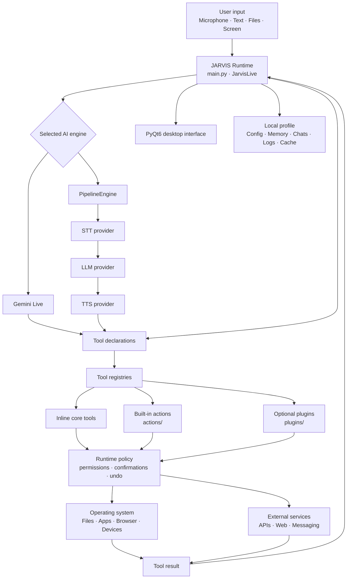
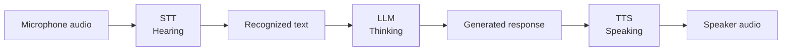

<p align="center">
  
</p>

<h1 align="center">JARVIS</h1>

<p align="center">
  <strong>Your Desktop. Your Intelligence. Your Control.</strong><br>
  A cross-platform desktop AI assistant that connects voice, models, memory, tools and your operating system.
</p>

<p align="center">
  <a href="https://github.com/RustamovAkrom/JARVIS/actions/workflows/tests.yml?query=branch%3Amain"></a>
  <a href="https://github.com/RustamovAkrom/JARVIS/actions/workflows/tests.yml?query=branch%3Av2"></a>
  
  
  <a href="https://github.com/RustamovAkrom/JARVIS/releases/latest"></a>
  <a href="LICENSE"></a>
</p>

<p align="center">
  <a href="#overview">Overview</a> ·
  <a href="#features">Features</a> ·
  <a href="#architecture">Architecture</a> ·
  <a href="#ai-engine-and-providers">AI Providers</a> ·
  <a href="#customization-guide">Customization</a> ·
  <a href="#integrations-and-plugins">Integrations</a> ·
  <a href="#installation">Installation</a> ·
  <a href="#development">Development</a>
</p>

---

## Overview

JARVIS is a desktop AI assistant designed to work as an interface between a person, AI models and the local operating system. It is not only a chat window: it combines a real-time voice conversation, a configurable AI engine, a permission-aware tool runtime, persistent local data, a customizable HUD and an extension system.

The application is built around a few central ideas:

- **One assistant, multiple engines.** Gemini Live is the default conversational engine. An independent provider pipeline can combine speech recognition, an LLM and speech synthesis, including local services.
- **Tools are separate from the model.** The model chooses a declared action; JARVIS validates and dispatches it through the local runtime. Actions and plugins do the actual work.
- **Capabilities are explicit.** A model is offered only tools that its engine can support. Computer interaction is separately controlled by Chat/Agent mode, permission switches and approval rules.
- **User data survives application updates.** Configuration, memory, databases, logs, plugin settings, caches and lecture recordings live in a runtime data profile rather than in replaceable application files.
- **The interface is part of the product.** The orbital HUD, telemetry, chat, conversations, tasks, activity, project workspace, editor and terminal are integrated into one desktop experience.

JARVIS is an actively developed project. The repository's default branch is main; v2 is the development branch referenced by the current implementation and its CI workflow. Prebuilt stable packages are currently published for Windows. macOS and Linux users can run the source version using the platform setup instructions below.

## Contents

- [Overview](#overview)
- [Features](#features)
- [Architecture](#architecture)
- [Core systems](#core-systems)
- [AI engine and providers](#ai-engine-and-providers)
- [Built-in actions](#built-in-actions)
- [Integrations and plugins](#integrations-and-plugins)
- [Customization guide](#customization-guide)
- [Security and privacy](#security-and-privacy)
- [Platform compatibility](#platform-compatibility)
- [Installation](#installation)
- [Runtime data and profiles](#runtime-data-and-profiles)
- [Troubleshooting](#troubleshooting)
- [Development](#development)
- [Releases and updates](#releases-and-updates)
- [Documentation](#documentation)
- [Contributing](#contributing)
- [Support and license](#support-and-license)

## Features

### Voice-first conversation

JARVIS can operate as a live voice assistant or as a typed conversational interface.

- Real-time microphone input and streamed spoken responses in Gemini Live mode.
- Typed messages, conversation switching and persistent chat history.
- File and screenshot attachments for context-aware questions.
- Push-to-talk as an alternative to always-available microphone input.
- Optional local **Hey Jarvis** wake-word detection.
- Configurable assistant identity and voice.
- Interrupt support so the user can stop an ongoing response.
- Optional proactive audio behavior and a morning brief.

Wake-word detection uses a local openwakeword model. The wake-word detector runs locally; enabling it does not mean that every later assistant feature is offline. Once a conversation starts, audio and other content are handled by the selected conversation engine.

### Vision and camera

JARVIS can receive a screen or camera capture as part of a conversation.

- Capture the desktop and ask questions about the visible content.
- Capture a webcam frame for visual questions.
- Keep a camera preview active when a feature needs a live view.
- Attach screenshots or selected screen regions to a chat.
- Use optional vision-capable plugins such as Build Guide, Calorie Counter and God's Eye.

Vision depends on the selected engine. Gemini Live supports the default vision path; an alternative model must explicitly support images. JARVIS probes and records the image capability of compatible local models before offering vision-dependent tools.

### Computer and desktop assistance

With permissions enabled, JARVIS can interact with supported desktop applications and operating-system controls.

- Open applications and URLs.
- Inspect the screen and locate interface elements.
- Move the pointer, click, drag, scroll, type and use keyboard shortcuts.
- Work with windows, browser tabs, volume, brightness and selected system settings.
- Organize desktop files and perform supported file operations.
- Send messages through configured messaging applications.
- Ask for confirmation before defined high-impact operations.

Computer control is not unrestricted by default. Chat mode blocks mutating computer actions. Agent mode enables them only within the configured permissions and approval policy. See [Security and privacy](#security-and-privacy).

### Project workspace and coding

The Project workspace is intended for working on a selected codebase without asking JARVIS to search arbitrary locations.

- Select a project folder in the Project panel.
- List and read files in that selected workspace.
- Open text files in the built-in editor or the operating system's default application.
- Start terminal sessions in the selected project folder.
- Ask the coding tools to create a project, write or modify code, explain files, run code and help diagnose errors.
- Use file processing for supported documents, data files, media and archives.

The workspace_files action is read-only and scoped to the selected project. Other tools, such as file_controller and dev_agent, have broader or write-capable behavior and are governed separately.

### Memory and conversations

JARVIS keeps conversational history and long-term saved memory as separate concepts.

- Conversations are stored as independent chat sessions.
- Long-term memory stores selected facts and session summaries.
- Memory can be searched, reviewed and edited through the interface.
- Relevant saved entries can be retrieved when a later conversation needs them.
- Runtime data is stored in the active user profile and is not overwritten by ordinary application updates.

Saved memory is not a transcript of every conversation. It is a separate store of selected information. Back up the JARVIS profile if you want to preserve chats, settings and memory.

### HUD and system telemetry

The desktop interface includes:

- An animated orbital core and assistant status display.
- System telemetry for CPU, memory, network, GPU and temperature where the host exposes the required information.
- CPU and memory history charts.
- Chat, conversations, tasks and activity surfaces.
- Project exploration, editor and terminal surfaces.
- Optional live dashboards supplied by plugins.

GPU and temperature values can show N/A when the hardware, driver or operating system does not expose a supported sensor. That does not necessarily indicate an application error.

### Background work and reminders

- Persistent, read-only background research tasks.
- Task status, result retrieval and cancellation.
- Topic monitoring with periodic checks for new public headlines.
- Timed reminders using the platform's available scheduling mechanism.
- Optional Pomodoro focus sessions and water reminders through plugins.

Background research is bounded: the manager limits concurrent work and stores a finite task history. It is intended for research and reporting, not for silently performing arbitrary computer changes.

### Remote access

JARVIS includes two distinct remote-control approaches:

- **Remote Dashboard:** a browser-based interface for a paired device on the local network. It can relay commands and supported phone audio to the desktop session.
- **Telegram Remote plugin:** an optional Telegram-based command relay that uses outbound HTTPS polling and an explicit chat allowlist.

These are separate features with different security and network properties. Read the [Remote access security notes](#remote-access-security) before enabling either.

## Architecture

JARVIS is organized around a runtime coordinator, an interface layer, model engines, tool registries and persistent services. The LLM does not directly execute operating-system operations. It receives tool declarations and returns a tool call; the local application applies policy, dispatches the handler and sends the result back into the conversation.

### High-level system flow



### Runtime responsibilities

| Component | Responsibility |
|---|---|
| main.py | Starts the assistant runtime, opens AI sessions, routes audio and text, builds tool declarations, dispatches tool calls and manages reconnect/shutdown behavior. |
| ui.py | Compatibility-facing UI entry point and public imports used by the application. |
| gui/app/ | Main window, chat store and application-level UI behavior. |
| gui/panels/ | System monitor, activity and debug panel components. |
| gui/settings/ | Settings categories, navigation, setting metadata and settings-page composition. |
| core/action_loader.py | Discovers, validates and dispatches built-in actions declared in actions/. |
| core/plugin_loader.py | Discovers plugins, validates their contract, tracks enable state, exposes settings and dispatches plugin calls. |
| providers/ | Defines provider contracts, provider discovery, capability metadata and the alternative STT → LLM → TTS engine. |
| memory/ | Persists configuration, provider settings, plugin settings, saved memory and translations. |
| core/runtime_paths.py | Resolves source, installed and portable runtime paths and initializes user-data directories. |
| dashboard/ | Implements the optional paired-device web dashboard and its local API. |
| tests/ | Unit and regression tests for runtime, permissions, providers, UI, storage and platform behavior. |

### Tool-dispatch lifecycle

1. **Discovery:** on startup, JARVIS loads inline tools, scans actions/ for modules that declare a TOOL object, and scans built-in and user plugin directories for plugin declarations.
2. **Validation:** the registries check tool names, descriptions, schemas, handlers and name collisions. A broken module is reported and skipped instead of aborting the entire discovery pass.
3. **Declaration:** the active engine receives the tools it can support. Disabled plugins are omitted. A model without vision support is not offered vision-dependent tools.
4. **Selection:** the model returns a structured function call. The model chooses the tool; local Python code executes it.
5. **Policy enforcement:** JARVIS checks the current mode, relevant permissions and whether the action requires user confirmation.
6. **Execution:** the selected action or plugin runs through its registry. Long-running or non-blocking operations use the relevant background mechanism where implemented.
7. **Result handling:** JARVIS records the outcome, returns the tool result to the engine and presents or speaks the response.

This separation lets a developer add a tool without putting every implementation branch into main.py. It also creates a clear place to review an extension's permissions and side effects.

### Three extension layers

**Inline core tools** live in main.py because they are tightly coupled to the live-session lifecycle. Examples include screen capture, memory operations, shutdown, monitor management and system status.

**Built-in actions** live in actions/. An action module exposes a TOOL declaration and a callable handler. The action loader discovers it automatically.

**Plugins** live in plugins/ or in the active user's plugin directory. A plugin exposes a PLUGIN declaration and a run() handler. It may also declare PLUGIN_SETTINGS to generate a configuration form in the UI.

Actions are intended for general assistant capabilities and operating-system operations. Plugins are optional feature packages and integrations that users can enable or disable.

## Core systems

### 1. Conversation runtime

JarvisLive is the session coordinator in main.py. It connects the UI to the active AI engine and owns the conversational lifecycle.

Its responsibilities include:

- Loading assistant identity, user preferences and saved memory.
- Building the system context for the selected chat and project workspace.
- Combining inline tools, discovered actions and enabled plugins into the tool catalogue.
- Applying engine capability filtering before opening a session.
- Capturing and forwarding microphone input.
- Receiving transcripts, audio output and tool calls.
- Executing tool calls and returning structured results.
- Reconnecting after session or transport problems.
- Saving chat/session context and shutting down background services.

The UI does not decide which model tool to call. It reports user input and displays runtime state; the model proposes tool calls and the local dispatcher decides whether they may run.

### 2. AI engine abstraction

JARVIS has two conversation paths:

- **Gemini Live:** the integrated real-time engine and default experience.
- **PipelineEngine:** an alternative engine assembled from separate provider components.

The provider layer normalizes messages, tool calls, transcription and speech output behind interfaces defined in providers/base.py. This prevents the rest of the application from depending directly on one LLM vendor's request and response objects.

A selected engine advertises capabilities such as vision, native tool calling, tool format, audio output and tool budget. JARVIS uses those capabilities when building the session configuration. A text-only model must not receive a screen-analysis tool that it cannot use.

### 3. Action registry

core/action_loader.py scans actions/*.py in deterministic filename order. A module is considered an action only when it declares a module-level TOOL dictionary with a valid name, description, parameter schema and callable handler.

The handler receives only the context parameters that its signature declares. Invalid modules and conflicting names are logged and skipped.

This makes built-in action development modular:

- Add an action module.
- Define the tool declaration and handler.
- Keep OS-specific work inside the module or a supporting core service.
- Add tests for its behavior, permission boundary and failure cases.

### 4. Plugin registry

core/plugin_loader.py provides a similar discovery and validation path for optional plugins.

A plugin can declare:

- PLUGIN: name, description, JSON-style parameter schema and tool metadata.
- run(parameters, ...): synchronous tool handler.
- PLUGIN_SETTINGS: optional configuration namespace, UI fields and optional test action.
- Optional execution metadata for blocking behavior and result scheduling.
- Optional startup initialization for enabled plugins.

The UI reads plugin metadata to show availability, enable state, error details and settings. Enabling or disabling a discovered plugin changes whether its tool is offered to the model; newly added Python modules are discovered at startup, so restart JARVIS after adding or replacing plugin code.

**Important:** Python plugins are not sandboxed. Importing and running a plugin executes code with the current user's permissions. A plugin is not a restricted container or a separate security boundary.

### 5. Provider registry

providers/registry.py loads provider definitions on demand and caches constructed instances by provider configuration. This avoids importing heavyweight optional speech/model packages at normal startup and avoids reloading local models for every request.

Every provider declares its kind, configuration fields, availability requirements, capabilities and factory. The settings UI can build forms from that declaration rather than hardcoding provider-specific forms into the main window.

### 6. Memory and chat storage

JARVIS has separate persistence paths for separate kinds of information:

| Data | Purpose |
|---|---|
| Chat store | Independent conversation sessions and their message context. |
| Long-term memory | Selected facts and summaries that can be retrieved across conversations. |
| Configuration | Assistant identity, UI preferences, audio devices, permissions, integrations and provider settings. |
| Plugin configuration | Namespaced settings for installed plugins. |
| Background task store | Status and results for persistent background research. |
| Logs | Runtime diagnostics and activity information. |
| Cache | Browser profiles, model caches and temporary application data. |
| Lectures | Locally recorded lecture audio. |

Memory and chat history are not interchangeable. Removing a saved fact does not mean a whole conversation is removed, and clearing a chat does not necessarily remove saved long-term memory.

### 7. Background execution, proactive work and undo

JARVIS includes several distinct mechanisms:

- **Background research:** runs read-only web research outside the immediate response loop, with bounded concurrency and persisted results.
- **Topic monitoring:** checks configured public topics periodically and reports new headlines. The current monitor explicitly rejects certain sensitive topic categories, including crypto, financial and trading topics.
- **Reminders:** creates time-based notifications using the host operating system's available scheduling support.
- **Proactive behavior:** builds context for optional briefings or time-aware prompts when enabled.
- **Undo:** reversible actions can register a reverse operation with the shared undo stack. The stack is bounded and only covers actions that explicitly opt in; it is not a universal operating-system undo.
- **Confirmation gate:** operations that require approval are held until the user confirms or cancels them. Pending confirmation expires after its configured timeout.

## AI engine and providers

Open **SETUP → ENGINE & PROVIDERS** (or the AI Providers entry in the Settings navigation) to configure the AI runtime. The provider panel keeps the Online and Offline configurations separate.

### Runtime selection: Online, Offline and Auto

| Mode | Behavior | Typical configuration |
|---|---|---|
| **Online** | Uses the configured Online engine and provider profile. | Gemini Live, or an Online pipeline with hosted providers. |
| **Offline** | Uses the configured local pipeline. | Local LLM plus local speech providers as needed. |
| **Auto** | Prefers Online when its configured route is reachable; selects Offline when Online is unavailable and the local profile passes readiness checks. | A working Online profile and a ready local fallback profile. |

Auto is a routing policy, not a guarantee that every feature is offline. The application periodically reevaluates the route. A local profile must have a usable LLM and any configured local STT/TTS components must be available. A missing model, uninstalled local dependency or unavailable local service can prevent Offline from being considered ready.

### Gemini Live

Gemini Live is the default real-time conversation experience.

To configure it:

1. Create a Gemini API key in [Google AI Studio](https://aistudio.google.com/apikey).
2. Start JARVIS and complete the first-run setup, or open the provider settings later.
3. Enter the key in the Gemini configuration.
4. Keep the key in the local JARVIS configuration. Never commit it or paste it into a public issue.
5. Check Google's current model access, quotas and pricing for the project associated with the key.

Gemini Live is different from an ordinary REST text request. A REST model ID cannot automatically replace a Live model. The code's current model list and fallback behavior can change as Google's API evolves; see [Gemini configuration](docs/gemini.md).

### Alternative STT → LLM → TTS pipeline

The pipeline has three independent slots. They can use different providers and can mix local and hosted services.



| Slot | Available implementation | Notes |
|---|---|---|
| STT / Hearing | Local faster-whisper; compatible hosted transcription endpoints including Groq and OpenAI presets. | Local Whisper defaults to CPU. CUDA is an optional setting when the environment supports it. |
| LLM / Thinking | OpenAI-compatible endpoints and provider presets. | The server must expose a compatible Chat Completions API. Tool calling and vision depend on the server and model. |
| TTS / Speaking | System-installed voices, local Piper, ElevenLabs. | Piper voice models may need a one-time download. ElevenLabs requires an API key and network access. |

The provider catalogue includes presets for:

- **Local model servers:** Ollama, LM Studio, llama.cpp server, vLLM and Jan.
- **Hosted APIs:** OpenAI, Groq, DeepSeek, Mistral, xAI, OpenRouter, Together and Cerebras.
- **Custom endpoints:** an OpenAI Chat Completions-compatible URL can be entered manually.

These are provider presets, not bundled AI models. You must install and start a local model server separately, download a model in that server, and configure the matching endpoint and model ID in JARVIS.

Example local endpoints:

| Server | Typical API base URL |
|---|---|
| Ollama | http://127.0.0.1:11434/v1 |
| LM Studio | http://127.0.0.1:1234/v1 |
| llama.cpp server | http://127.0.0.1:8080/v1 |
| vLLM | http://127.0.0.1:8000/v1 |
| Jan | http://127.0.0.1:1337/v1 |

The exact address depends on how the server was started. Enter the URL, list or type the model ID, run the provider test when available, and select **SAVE & APPLY**.

### Local pipeline setup

A typical fully local configuration is:

1. Install a local LLM server such as Ollama or LM Studio.
2. Download a model that supports the tasks you need.
3. Configure the LLM slot to point at the server's OpenAI-compatible endpoint.
4. Select local Whisper for STT if voice input is required.
5. Select Piper or System Voice for TTS if spoken output is required.
6. Test each configured provider and apply the changes.
7. Select Offline mode.

A fully local voice path requires local implementations in all three slots. Leaving a slot unconfigured means that capability may not be available. Local inference still requires CPU/RAM resources and may be slower than a hosted service.

### Model capabilities and tool compatibility

Not all models provide the same capabilities.

- **Tool calling:** a model/server must support function or tool calling, or be compatible with the configured prompt-based tool protocol. Some small local models need a reduced tool budget.
- **Vision:** a model must accept image input. JARVIS tests compatible models and records the result.
- **Audio output:** an LLM does not automatically speak. The pipeline needs a configured TTS provider to produce speech.
- **Interruption:** behavior differs between Gemini Live and the pipeline. Local generation may not stop at exactly the same point as a native live-audio session.
- **Background tool scheduling:** non-blocking tool behavior depends on the engine's capabilities. A provider that lacks this feature may run the tool synchronously.

Provider capability flags are used to filter tools before a session starts. If a model cannot process images or tool calls, the related capability should not be assumed to work simply because the UI can display its setting.

### Sidecar provider

An optional sidecar LLM can handle eligible short background requests separately from the main conversation engine. The **Sidecar first** preference controls whether it is preferred for those requests. It does not replace the model used for the active conversation.

For provider-specific configuration and troubleshooting, see [Local and third-party models](docs/local-llm.md).

## Built-in actions

Built-in actions are the reusable tools exposed to the assistant from actions/. The following groups describe the current implementation; exact behavior can depend on the host operating system, installed applications, selected engine and granted permissions.

| Area | Actions and capabilities |
|---|---|
| Web and research | Web search, news lookup, research, price lookup and comparison. |
| Browser | Open URLs, manage browser sessions and interact with pages through the browser automation layer. |
| Applications | Discover and open installed applications, with launch verification where supported. |
| Computer control | Screen inspection, element discovery, pointer, mouse and keyboard actions, clipboard operations and selected window controls. |
| System settings | Supported media, volume, brightness, display, window, Wi-Fi and operating-system actions. Some actions are platform-specific. |
| Files | List, create, read, write, move, copy, rename, delete-to-Trash, search and inspect supported file paths. |
| Project workspace | Read files from the selected project, inspect the active editor file and open a selected project folder in JARVIS. |
| Coding | Write, edit, explain, run and help debug code; create project structures and run project build commands. |
| File processing | Process supported images, PDF, Word, text, CSV, Excel, JSON/XML, code, audio, video, ZIP archives and PowerPoint files. |
| Communication | Send messages through supported desktop messaging clients and configured integrations. |
| Media | Play local media, direct media URLs and supported YouTube sources. |
| Reminders and monitoring | Create reminders, manage monitored topics and start/read/cancel background research. |
| Travel and weather | Search flight options and retrieve weather information. |
| System monitoring | Read system status and telemetry where supported. |

Some tools are deliberately read-only. For example, workspace_files is restricted to the selected project folder and provides list/read operations. The general file controller supports broader operations and therefore has a different permission boundary.

## Integrations and plugins

Plugins are optional systems that extend JARVIS without changing the main runtime. They are discovered from the repository's plugins/ folder and the active user's plugin folder. Open **SETUP → PLUGINS** to enable or disable discovered plugins. Use **PLUGIN SETTINGS** for integrations that declare their own settings form.

A plugin may require an API key, account authorization, a local application, an additional Python dependency, a camera, a browser runtime or operating-system permissions. A plugin being present in the repository does not mean that every feature is active or configured.

### Current plugin catalogue

The following groups summarize plugins in the v2 source tree.

| Category | Plugin | Capability |
|---|---|---|
| System dashboards | system_dashboard | Live CPU, memory, GPU, disk, network, battery and process views where data is available. |
| System dashboards | battery_dashboard | Battery status and history on supported devices. |
| System dashboards | disk_dashboard | Disk usage, available space and selected cache maintenance. |
| System dashboards | network_dashboard | Network throughput, latency and interface diagnostics. |
| Network tools | network_radar | Discover devices visible on the local network, inspect device information and optionally watch for new devices. Use only on networks you own or are authorized to assess. |
| Visual assistance | gesture_control | Camera-based hand gestures for assistant interruption and supported media/volume controls. Uses local hand-detection components. |
| Visual assistance | build_guide | Camera, screen or image-based component identification, assembly guidance, connection diagrams and visual troubleshooting. |
| Visual assistance | calorie_counter | AI-assisted food-image analysis and estimated nutrition information. Estimates are not medical measurements. |
| Visual assistance | gods_eye_plugin | God's Eye globe/map interface and search for streams explicitly marked live. |
| Visual assistance | planet_watch | Globe and map views with public information such as earthquakes, disaster alerts, aircraft, weather and the ISS. Data availability depends on external sources. |
| Documents and productivity | document_review | Explain and structure findings from uploaded or selected documents. Content may be sent to the selected AI provider. |
| Documents and productivity | excel_writer | Generate Excel workbooks from a natural-language description. |
| Documents and productivity | obsidian_vault | Search, read, create and append notes in a configured local Obsidian vault. |
| Documents and productivity | quiz | Display interactive quizzes generated from the active conversation context. |
| Documents and productivity | pomodoro | Focus sessions, breaks and locally stored focus statistics. |
| Documents and productivity | water_reminder | Local hydration tracking and scheduled reminders. |
| Communication | chat_takeover | Optional screen-based chat assistance and reply automation. Requires careful use of screen and input permissions. |
| Communication | whatsapp_call | Place or manage supported WhatsApp calls through the configured desktop or browser transport. |
| Communication | whatsapp_guard | Watch for incoming WhatsApp calls and apply the configured answer/decline workflow. |
| Communication | telegram_remote | Pair authorized Telegram chats for remote commands and supported message/file relays. |
| Media | spotify_control | Search and control playback through an authorized Spotify account and device. |
| Gaming | game_updater | Inspect and manage supported Steam/Epic library installation and update operations. |
| Research and data | trading_agent | Retrieve market quotes, public headlines and technical summaries. It does not replace independent financial research or professional advice. |

The repository may gain or change plugins as development continues. The runtime plugin manager is the authoritative view of the plugins discovered by your installation. For the plugin contract, settings schema and implementation examples, see [Plugin guide](docs/plugins.md).

### Configure an integration

The general pattern is:

1. Open **SETUP → PLUGINS** and enable the plugin.
2. Open **PLUGIN SETTINGS**.
3. Read the plugin's required fields and enter only the credentials or paths it needs.
4. Use the plugin's **TEST** action when one is provided.
5. Save/apply the settings and try a small, non-destructive operation.
6. Review the plugin's permissions, network behavior and data handling before using it with private information.

Examples:

- **Spotify:** create/configure the Spotify API application and authorize the account using the plugin's setup fields.
- **Telegram Remote:** create a Telegram bot, configure its token and explicitly allow the chat IDs that may send commands.
- **Obsidian:** point the plugin to the intended vault folder. The plugin works with local Markdown files; it does not need a separate Obsidian cloud API.
- **Ollama / LM Studio:** start the local server first, then configure the OpenAI-compatible LLM provider in Engine & Providers. These are providers, not plugins.
- **WhatsApp:** configure the WhatsApp integration and choose the supported desktop or browser transport. UI automation may vary with application updates and platform permissions.

## Customization guide

Most everyday customization is available from the desktop UI. Settings are stored in the active JARVIS profile and are not tied to a single executable version.

### Settings categories

| Category | What you can customize |
|---|---|
| General | Interface language, startup behavior, fullscreen and everyday assistant behavior. |
| Assistant Identity | Assistant display name, user name and assistant voice. |
| Voice & Audio | Microphone, output device, volume, wake word and push-to-talk. |
| Appearance & Personalization | Theme/accent, window opacity, HUD appearance and visual preferences. |
| Workspace & Layout | Visible panels, selected project folder and how text files are opened. |
| Cursor Assistant | Cursor appearance, size, shortcuts and quick-action menu. |
| Security & Permissions | Chat/Agent mode, action permissions, approval policy and available authentication integration. |
| AI Providers | Online/Offline/Auto mode, engines, provider fields, credentials and sidecar. |
| Plugins | Installed plugin state and per-plugin settings. |
| Memory | Review and manage saved facts. |
| Developer & Diagnostics | Developer options, logs and diagnostics. |
| Updates & Maintenance | Version information and update operations. |

### Personalize the assistant

1. Open Settings and choose **Assistant Identity**.
2. Set the assistant's display name and, optionally, the name it uses when addressing you.
3. Select a voice supported by the active engine.
4. Save/apply the changes.

Gemini Live exposes its configured prebuilt voices. The alternative pipeline uses the voice options supplied by its selected TTS provider. A voice available in one engine is not necessarily available in another.

### Change the appearance

Open **Appearance & Personalization** (or the existing Customize surface) to adjust:

- Theme preset and accent color.
- Main window opacity / glass appearance.
- HUD style where supported by the active UI.
- Panel visibility and layout controls.
- Fullscreen behavior.

The interface can show or hide side panels independently. GPU and thermal metric availability is determined by the host hardware and drivers, not by the theme settings.

### Configure the cursor assistant

Open **Cursor Assistant** or the cursor options under Controls.

- Select a cursor style: halo, orb, reticle or dot.
- Choose a supported cursor size.
- Set the quick-action shortcut.
- Set the region-selection shortcut.
- Choose which quick actions appear in the cursor menu.

The available quick actions include microphone, ask, attach, summarize, explain, translate, fix, screen, interrupt and settings. The selected actions are presented as a convenience layer; they do not grant computer permissions by themselves.

### Configure voice input

Open **Voice & Audio**.

1. Select the intended microphone.
2. Use the input test and check that the operating system grants microphone access.
3. Select the speaker/output device.
4. Check output volume and test spoken playback.
5. Choose either normal microphone interaction, push-to-talk or the optional wake-word flow.

The wake phrase is **Hey Jarvis**. The optional wake-word package/model may need to be installed from its setup control. Push-to-talk uses the configured keyboard shortcut and is useful when the microphone should not remain active for the whole time JARVIS is open.

### Configure AI behavior

Open **AI Providers** / **ENGINE & PROVIDERS**.

- Choose Online, Offline or Auto.
- Keep Online and Offline provider profiles configured separately.
- Select the LLM, STT and TTS slots for the desired pipeline.
- Configure endpoint, model, key and advanced fields only when required.
- Use provider tests and **SAVE & APPLY**.
- Configure the optional sidecar independently from the main conversation LLM.

Do not assume that changing the LLM also changes the speech recognizer or voice. Those are separate slots.

### Configure computer permissions

Open **Security & Permissions**.

The mode and permission switches work together:

- **Chat mode:** blocks mutating computer actions.
- **Agent mode:** allows eligible computer actions only when their required permissions are enabled.
- **Observe screen:** permits screen observation.
- **Find elements:** permits interface discovery and supported window targeting.
- **Move mouse:** permits pointer movement and scrolling.
- **Click:** permits click and drag operations that require clicking.
- **Type:** permits keyboard and text entry.
- **Clipboard:** permits clipboard operations.

The shipped defaults are conservative for input control: screen observation is enabled, while element discovery, mouse movement, clicking, typing and clipboard access are disabled until explicitly enabled.

The approval policy controls when JARVIS asks before an action:

- **Ask:** requests confirmation for actions in the approval-controlled scope.
- **Approve:** requests confirmation for high-impact actions such as sending a message, deleting a file, closing an application or running a project-building agent.
- **Full:** temporarily relaxes general approval prompts for permitted actions. Full Access is time-limited; it is not a permanent permission grant. High-impact operations can still require confirmation.

Permission switches remain the actual capability boundary. Choosing Agent mode or Full approval does not enable a permission switch that is off. JARVIS also rechecks policy when an action is confirmed, so revoking permission while a prompt is waiting can cancel the operation.

### Plan mode

Plan mode is distinct from Agent mode. It is intended for analysis and planning without carrying out normal state-changing tools. Use it to ask JARVIS to inspect the available context and prepare steps before authorizing changes.

### Manage memory and conversations

- Use **Conversations** to switch between saved chats.
- Use **Memory** to inspect and manage long-term facts.
- Use the memory search/recall behavior when JARVIS needs an older saved fact.
- Back up the active profile before manually editing JSON or removing stored data.

Chat history and saved facts are stored separately. Treat them as separate data stores when exporting, backing up or deleting information.

### Configure the project workspace

1. Open **PROJECT** / Workspace & Layout.
2. Select the root folder of the project you want JARVIS to inspect.
3. Use the file explorer to browse files.
4. Open text files in the built-in editor or the system application, depending on your preference.
5. Start a terminal session; it uses the selected project folder as its working directory.

The project-file assistant action is read-only. The coding agent and general file tools may write files or execute commands, so use those only when you intend to make changes.

### Keyboard shortcuts

| Shortcut | Function |
|---|---|
| F4 | Toggle microphone mute. |
| F11 | Toggle fullscreen. |
| Escape | Interrupt the current response. |
| Ctrl+K | Open the command palette. |
| Ctrl+Shift+Space | Open cursor quick actions. |
| Ctrl+Alt+R | Start region selection. |
| Win+Shift+S | Open the Windows region capture tool. Use Ctrl+V in JARVIS to attach the copied image. |

Global shortcut availability depends on the operating system, desktop session and whether another application owns the same key combination. The shortcut configuration should be checked on the machine where JARVIS is running.

## Security and privacy

JARVIS can access sensitive local resources when the user enables the relevant feature. Its security model should be understood as a set of explicit controls, not as a claim that every tool is sandboxed.

### Computer access model

- Chat mode blocks mutating actions in the computer-action scope.
- Agent mode is required for normal computer changes.
- Individual capabilities are checked before dispatch.
- Higher-impact actions can require an approval prompt.
- Confirmation is time-limited and can be cancelled.
- Permission and mode are checked again when a queued action is approved.
- Plan mode blocks normal state-changing tools while planning.

The per-action permission model currently covers screen observation, interface discovery, pointer movement, clicking, typing and clipboard access. Other actions, such as external messaging, file deletion and project creation, have additional approval rules.

### Reversible and high-impact operations

JARVIS has an undo stack for operations whose handlers explicitly register a reverse operation. This can help recover from supported file and system changes. It does not cover every action, every application or every external service.

Some actions cannot be reliably undone. Sending a message is an example: once a recipient receives it, local application state cannot retract the external delivery. Such operations use a confirmation gate.

### Plugins execute with user permissions

Plugins are Python modules. They are not sandboxed and can access files, network resources, applications and devices available to the current user. Before enabling an unfamiliar plugin:

- Review its source code.
- Review its declared settings and required credentials.
- Understand what data it reads or sends.
- Check whether it performs write, install, messaging or device-control operations.
- Disable it when it is no longer needed.

The plugin schema helps JARVIS describe and route a plugin. It is not a security sandbox.

### Cloud and local data handling

When a cloud provider is selected, relevant conversation content may be sent to that provider. Depending on the feature, that can include:

- Microphone audio or recognized transcripts.
- Text prompts and conversation context.
- Uploaded files and images.
- Screen or camera captures explicitly requested by the user.
- Tool results needed to answer a request.

A fully local STT/LLM/TTS configuration keeps those model stages on the device, but web search, online integrations, messaging services and plugins can still use the network. Review the provider and plugin configuration before sending private material.

Never commit or publish:

- config/api_keys.json
- API keys, bot tokens, OAuth credentials or pairing codes
- Private chat history and saved memory
- Personal project files or private recordings
- Logs containing credentials or private content

### Remote access security

**Remote Dashboard**

The dashboard is designed for pairing a trusted device on the local network. It uses a short-lived one-time pairing code and expiring session tokens with rate limiting. HTTP is the default transport in the current implementation. HTTPS can be enabled using the dashboard_https setting in the local JARVIS configuration; the application generates a self-signed certificate, which must be accepted by each client device.

Important implications:

- Plain HTTP does not provide transport encryption. Treat it as local-network traffic visible to devices that can observe that network.
- HTTPS uses a self-signed certificate, not a publicly trusted certificate authority.
- Do not expose the dashboard directly to the public internet or configure router port forwarding as a shortcut.
- Use only trusted networks and paired devices.
- Keep pairing codes and device credentials private.
- Revoke device access when a device is no longer trusted.

**Telegram Remote**

Telegram Remote uses outbound HTTPS polling rather than requiring an inbound port. Configure a bot token and an explicit allowlist of authorized chat IDs. Protect the token as a password, keep the allowlist narrow, and disable the plugin when remote access is not needed.

### Face activation is not OS authentication

The optional Face Activation plugin provides a JARVIS application overlay with local passphrase/PIN recovery and optional face matching. It is not a Windows/macOS/Linux login screen, does not replace operating-system account security and should not be treated as an OS-level biometric security boundary.

### Use the network tools responsibly

Network Radar and OSINT-related features should only be used on networks, accounts and public sources that you are authorized to inspect. Market summaries and calorie estimates are informational outputs, not professional financial or medical advice.

## Platform compatibility

JARVIS targets Windows, macOS and Linux, but desktop automation capabilities depend on the current machine and desktop session.

| Platform | Source application | Computer interaction notes |
|---|---|---|
| Windows 11 / Windows | Supported and used for stable packaged releases. | Broadest integration coverage, including Windows-specific audio, window and application controls. |
| macOS | Supported from source. | Grant Accessibility permission for input automation and Screen Recording permission for screen capture under System Settings → Privacy & Security. |
| Linux X11 / Xorg | Supported from source. | Desktop actions depend on a graphical session and installed desktop utilities. xdotool or wmctrl helps focus already-running windows. |
| Linux Wayland | Source application can run, but cross-application automation is restricted. | Native Wayland intentionally limits one application from capturing or controlling another. Screen capture, synthetic input and window focus are therefore unavailable in this session. |

On a Linux system without a graphical session, voice, memory, files and web features may remain usable, but screen capture, pointer/keyboard control and window focus are unavailable.

Python 3.14 is the version declared and currently tested by the project's setup and CI configuration. The stable packaged release workflow currently produces Windows packages; macOS and Linux installation is from source.

## Installation

### Requirements

- Python **3.14**.
- Windows, macOS or Linux.
- Internet access for initial package/browser installation and hosted AI services.
- A Gemini API key for the default Gemini Live engine.
- A working microphone and speaker/headphones for voice interaction.
- A webcam only for features that use camera input.
- A local LLM server and downloaded model only when using a local pipeline.

GPU hardware is not required for the default application or CPU-based local Whisper configuration. Some optional providers and models can use CUDA where configured and supported.

### Windows — PowerShell

```powershell
git clone https://github.com/RustamovAkrom/JARVIS.git
cd JARVIS

py -3.14 -m venv .venv

.\.venv\Scripts\python.exe -m pip install --upgrade pip
.\.venv\Scripts\python.exe setup.py

.\.venv\Scripts\python.exe main.py
```

### Linux and macOS — Bash

```bash
git clone https://github.com/RustamovAkrom/JARVIS.git
cd JARVIS

python3.14 -m venv .venv

.venv/bin/python -m pip install --upgrade pip
.venv/bin/python setup.py

.venv/bin/python main.py
```

The setup script installs the Python packages from requirements.txt and downloads Chromium and Firefox runtimes used by browser automation. It detects the operating system and avoids installing platform-specific Python dependencies on unrelated platforms.

Some Linux integrations need native utilities supplied by the distribution. The setup script prints guidance for optional integrations; it does not silently install arbitrary system packages with elevated privileges.

### Optional installation with uv

Install [uv](https://docs.astral.sh/uv/getting-started/installation/) using its official instructions. From the repository root:

```bash
uv sync --no-install-project
uv run --no-sync python -m playwright install chromium firefox
uv run --no-sync python main.py
```

uv sync --no-install-project installs the dependencies from pyproject.toml and uv.lock without trying to package JARVIS as a distributable Python library.

### First launch

1. Start JARVIS using main.py.
2. Select the interface language.
3. Configure the Gemini API key for the default engine.
4. Select the microphone and output device.
5. Test audio input and playback.
6. Open Engine & Providers if you want to configure a different model pipeline.
7. Review Computer Permissions before enabling Agent mode or computer interaction.
8. Enable optional plugins individually and configure their settings.

### Recover browser runtimes

If Playwright browser installation was interrupted, rerun:

```bash
python -m playwright install chromium firefox
```

On Windows:

```powershell
.\.venv\Scripts\python.exe -m playwright install chromium firefox
```

JARVIS can still start without browser automation, but browser-dependent actions will not work until the required browser runtime is installed.

## Runtime data and profiles

JARVIS separates application resources from mutable user data. This prevents ordinary application replacement or updates from overwriting configuration, memory, logs, plugin settings and other user state.

### Source, installed and portable modes

| Runtime | Default data behavior |
|---|---|
| Source with DEBUG=true | Mutable data is stored in the source checkout. The generated .env and local configuration are git-ignored. |
| Source with DEBUG=false | Mutable data is stored under the operating system's user-data directory, using a development profile by default. |
| Installed Windows build | Mutable data is stored outside the versioned application files under the user's local application data directory. |
| Portable Windows build | Uses its own named user-data profile under the JARVIS application-data location rather than writing state beside replaceable executable files. |

A source checkout creates a local .env file with DEBUG=true when one does not exist. To move source-run data out of the checkout, set:

```dotenv
DEBUG=false
```

### Profile environment variables

| Variable | Purpose |
|---|---|
| DEBUG | For source runs, true stores mutable data in the checkout; false uses the OS user-data directory. Frozen builds always use external user data. |
| JARVIS_PROFILE=shared | Uses the shared JARVIS application-data root. |
| JARVIS_PROFILE=<name> | Uses a separate named profile. The name must contain only letters, numbers, dots, underscores or hyphens and begin with a letter/number. |
| JARVIS_PROFILE_DIR=<path> | Uses an explicit data directory. |
| JARVIS_DATA_DIR=<path> | Compatibility alias for an explicit data directory. |

JARVIS_PROFILE_DIR and JARVIS_DATA_DIR take precedence over the normal profile selection. Use separate profiles when you need isolated development, testing or personal configurations.

### Typical data locations

- **Windows:** %LOCALAPPDATA%/JARVIS/
- **macOS:** ~/Library/Application Support/JARVIS/
- **Linux:** $XDG_DATA_HOME/JARVIS/, or ~/.local/share/JARVIS/ when XDG_DATA_HOME is not set.

A profile contains directories such as config/, memory/, databases/, logs/, plugins/, cache/ and lectures/. The exact active path depends on runtime mode and profile selection.

On first launch, compatible legacy configuration and memory files may be copied into the active profile only when the destination does not already exist. The original files are retained. Back up the complete active profile to preserve settings, credentials, memory, chat data, plugin configuration and recordings.

## Troubleshooting

### JARVIS does not start

- Verify that Python 3.14 is selected in the active virtual environment.
- Run python setup.py again to confirm dependencies are installed.
- Check the console output and files under the active profile's logs/ directory.
- Confirm that the source tree is not missing files or partially updated.
- On Linux, check that required Qt system libraries are installed.

### Gemini connection or model errors

- Confirm that the API key belongs to the intended Google AI Studio project.
- Check that the project can access the configured model.
- Review quota, billing and service availability in Google's current documentation.
- Do not substitute a normal REST model ID for a Gemini Live model.
- See [Gemini configuration](docs/gemini.md).

### A local model connects but tools do not work

- Confirm that the server exposes an OpenAI Chat Completions-compatible API.
- Check that the selected model/server supports tool calling.
- Try a model with stronger function-calling support.
- Reduce the advanced tool budget for small local models if necessary.
- Make sure the tool is not filtered because the model lacks vision or tool capabilities.

### Offline mode is unavailable

- Configure a usable local LLM and select a model that the local server lists.
- Install optional provider dependencies such as faster-whisper or piper-tts when those providers are selected.
- Download the selected local speech model or Piper voice.
- Run the provider tests and use SAVE & APPLY.
- Use Auto only when the Offline profile passes readiness checks.

### No microphone input or no spoken output

- Check operating-system microphone permission.
- Select the correct input and output devices in Voice & Audio.
- Confirm that the microphone is not muted and that push-to-talk is configured as expected.
- Test a system voice or another TTS provider to isolate the speech output path.
- Check the operating system's audio mixer and device settings.

### Screen capture or computer control is unavailable

- Confirm that screen observation and required input permissions are enabled.
- Switch to Agent mode for mutating computer actions.
- On macOS, grant Accessibility and Screen Recording permissions.
- On Linux, check whether the current session is Wayland or X11/Xorg. Wayland intentionally restricts cross-application input and capture.
- On Linux X11, install xdotool or wmctrl if focusing existing windows is required.

### Browser automation does not open a browser

- Install the Playwright browser runtimes using the recovery command above.
- Check that the selected browser is installed and that its executable is discoverable.
- Retry after restarting JARVIS if the browser installation or profile was changed.

### GPU or temperature values show N/A

System sensors vary by GPU vendor, driver, laptop firmware and operating system. Check the device's driver and sensor utility. CPU and memory telemetry can work even when GPU or thermal readings are unavailable.

### A plugin is marked BROKEN or does not appear

- Open the plugin manager and read the reported import/validation error.
- Check required third-party packages and companion applications.
- Review the plugin's settings and required credentials.
- Restart JARVIS after adding or replacing a plugin's Python module.
- Check the console/log output for the plugin filename and failure reason.

## Development

### Development environment

Use Python 3.14 and create a virtual environment as described in [Installation](#installation). The setup.py installer is the project's platform-aware setup path. pyproject.toml defines project metadata and dependencies, while uv.lock records the uv dependency resolution.

### Run the test suite

The project uses unittest and runs its CI test matrix on Windows, Ubuntu and macOS with Python 3.14.

Bash:

```bash
QT_QPA_PLATFORM=offscreen python -m unittest discover -s tests -v
```

Windows PowerShell:

```powershell
$env:QT_QPA_PLATFORM = "offscreen"
.\.venv\Scripts\python.exe -m unittest discover -s tests -v
```

Qt tests use the offscreen platform in CI so they do not require an interactive desktop session. Some tests mock hardware, audio devices, cameras, network services or user configuration; a passing unit suite is not a substitute for testing the corresponding feature on real hardware.

### Add a built-in action

1. Create a module under actions/.
2. Declare a module-level TOOL dictionary with a unique name, description, parameter schema and callable handler.
3. Keep the handler focused and validate inputs before making changes.
4. Use the shared core services for permissions, confirmation, undo and runtime paths where applicable.
5. Add unit tests covering success, invalid input, platform limitations and failure behavior.
6. Run the complete test suite.

The action loader discovers modules that expose a valid TOOL declaration. Shared helper files should not expose a TOOL object.

### Add a plugin

Start with [plugins/_template.py](plugins/_template.py) and read [Plugin guide](docs/plugins.md).

A minimal plugin follows this shape:

```python
PLUGIN = {
    "name": "example_lookup",
    "description": "Searches a configured catalogue.",
    "parameters": {
        "type": "OBJECT",
        "properties": {
            "query": {
                "type": "STRING",
                "description": "Text to search for",
            }
        },
        "required": ["query"],
    },
}

def run(parameters, player=None, session_memory=None):
    query = str((parameters or {}).get("query", "")).strip()
    if not query:
        return "A search query is required."
    return f"Received query: {query}"
```

The plugin loader passes supported context parameters based on the handler signature. Keep plugin handlers bounded and avoid blocking the conversation loop. Long operations should use a suitable background worker/task mechanism. Declare PLUGIN_SETTINGS for namespaced fields that should appear in the UI. Never print credentials or sensitive data to logs.

### Development guidelines

- Keep UI code, runtime orchestration, provider implementations, actions and plugins in their respective layers.
- Do not put provider-specific request logic into the Qt UI.
- Do not bypass the action/plugin registry for ordinary tools.
- Do not assume that all models support vision, tools, audio output or non-blocking scheduling.
- Make computer-control permissions explicit and test both allowed and denied paths.
- Use timeouts for network and external-process operations.
- Keep mutable files in core.runtime_paths.PATHS rather than hardcoding source-tree paths.
- Add regression tests when fixing a lifecycle, threading, platform or UI bug.
- Keep credentials, profile data, recordings and private project files out of commits.

## Releases and updates

### Stable releases

The stable release workflow is defined in .github/workflows/release.yml.

- Automatic release packaging is triggered from main when pyproject.toml changes, or manually through GitHub Actions.
- The workflow reads the project version from pyproject.toml and creates a stable vMAJOR.MINOR.PATCH tag.
- The complete test workflow must pass before packaging starts.
- The package job runs on Windows, builds the application with PyInstaller and Velopack, and produces a SHA-256 manifest.
- The workflow publishes a GitHub Release from main.
- The current prebuilt stable packages are for Windows. macOS and Linux users should use the source installation instructions.

Download the latest package from [GitHub Releases](https://github.com/RustamovAkrom/JARVIS/releases/latest).

### In-app updates

The installed Windows application can check stable GitHub releases, download a package through the configured update feed, verify package metadata/integrity through the update mechanism and apply the update using Velopack.

Source runs can check release information but cannot replace their own source files in place. Update behavior depends on the runtime mode and whether package installation is supported.

### Branch and CI policy

- main is the default branch and the release source.
- v2 is the active development branch.
- The test workflow runs on pushes and pull requests targeting main and v2.
- The CI matrix covers Windows, Ubuntu and macOS using Python 3.14.
- The CodeQL workflow analyzes Python and GitHub Actions workflows on main.

A passing workflow on one branch does not imply that another branch has passed. Check the badge or the Actions page for the branch being tested.

## Documentation

| Document | Contents |
|---|---|
| [Gemini configuration](docs/gemini.md) | Gemini Live setup, API keys, model selection, quotas, data handling and troubleshooting. |
| [Local and third-party models](docs/local-llm.md) | Local model servers, hosted OpenAI-compatible providers, STT, LLM, TTS, sidecar and troubleshooting. |
| [Plugin guide](docs/plugins.md) | Plugin catalogue, plugin contract, settings forms, enable/disable behavior and development examples. |
| [UI settings architecture](docs/ui-settings-architecture.md) | Settings Center architecture, category registry, migration boundaries and persistence contract. |
| [UI functionality inventory](docs/ui-functionality-inventory.md) | Inventory of existing interface functionality. |
| [UI control handler map](docs/ui-control-handler-map.md) | Mapping between controls and their handlers. |
| [UI regression checklist](docs/ui-regression-checklist.md) | Regression checks for the desktop interface. |
| [UI baseline](docs/ui-baseline.md) | Current UI baseline and expected behavior. |
| [Known UI issues](docs/ui-known-issues.md) | Known interface issues tracked in the repository. |
| [GitHub Issues](https://github.com/RustamovAkrom/JARVIS/issues) | Bug reports, feature discussions and development tracking. |

## Contributing

Contributions are welcome. Before opening a pull request:

1. Check existing issues and pull requests to avoid duplicate work.
2. Keep the change scoped to the relevant architecture layer.
3. Add or update tests for changed behavior.
4. Run the unit test suite locally.
5. Document new settings, permissions, dependencies and external services.
6. Never include API keys, user profiles, private logs or personal files.

For a new plugin, include its required credentials, dependencies, network behavior, file access and security implications in its documentation.

## Support and license

- **GitHub Issues:** [Report a bug or request a feature](https://github.com/RustamovAkrom/JARVIS/issues)
- **Telegram:** [@Akrom_Rustamov](https://t.me/Akrom_Rustamov)
- **Portfolio:** [akrom-rustamov.vercel.app](https://akrom-rustamov.vercel.app/)

When reporting a problem, include the operating system, Python version, selected AI engine/provider, relevant steps to reproduce and a sanitized error log. Remove API keys, bot tokens, pairing codes, private file contents and personal information from logs and screenshots.

JARVIS is distributed under the [MIT License](LICENSE).

<p align="center">
  <strong>JARVIS</strong><br>
  <sub>Built to connect intelligence with the desktop.</sub>
</p>
